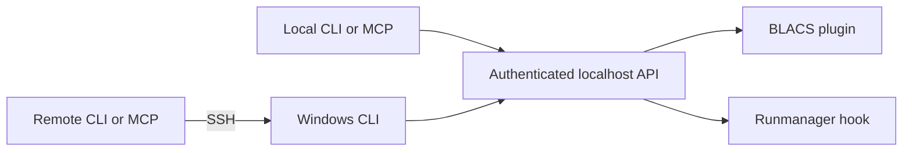

# labscript-control

[](https://github.com/kenji0923/labscript-control/actions/workflows/tests.yml)

Control **BLACS and Runmanager** from coding agents or a terminal, using a local
Windows connection or SSH from another computer. The same Python client backs
the CLI and an MCP server with 16 tools.

- Inspect application, device-tab, and queue state.
- Pause, resume, add, remove, and reorder queued shots.
- Restart individual device tabs or gracefully restart applications.
- Read/edit Runmanager globals and compile without submitting shots to BLACS.
- Reserve a PC across multiple commands with an expiring lease shared by both apps.
- Identify the actual target host and retain mutation receipts across app restarts.

The CLI requires Python 3.10+ and the standard library. MCP support is an optional
extra. Application bridges and interactive application startup currently target
Windows; remote clients also run on Linux.

## Architecture



GUI actions run on the application's Qt thread. Application startup uses Windows
Task Scheduler with the logged-on user's interactive token. Normal operations do
not depend on clicking screen coordinates.

## Install the client

```sh
git clone https://github.com/kenji0923/labscript-control.git
cd labscript-control
python -m venv .venv
# Activate the virtual environment using your shell's usual command.
python -m pip install '.[mcp]'
```

For CLI-only use, install `.` without the MCP extra.

Configure remote targets by copying [examples/targets.example.json](examples/targets.example.json)
to a private `targets.json`, then replace the example hostnames, SSH aliases, and
Python paths with your own. The target Python environment must also have this
package installed.

```sh
labctl --config targets.json --target lab-a status
labctl --config targets.json --target lab-b queue list
```

On the target Windows PC, use `labctl --local status`. Native Windows clients
also default to local operation when no target is specified. An explicitly named
target automatically uses local transport if its hostname matches this PC.

## Install the Windows bridges

Use the Python environment that already runs BLACS and Runmanager:

```powershell
$daqPython = 'C:\path\to\labscript-env\Scripts\python.exe'
& $daqPython -m pip install C:\src\labscript-control
& $daqPython -m labcontrol.install_windows --labscript-root C:\path\to\labscript-suite
```

The installer backs up the files it edits, installs a BLACS plugin and a small
Runmanager startup hook, and registers interactive application-start tasks. It
does **not** restart applications or execute shots. Gracefully restart both apps
to load the bridges. Package upgrades can replace the hooks; rerun the installer
if necessary.

For an isolated local MCP environment, install `.[mcp]` there and pass its Python
path with `--mcp-python` when running the installer. Agent configuration examples
are written to `%LOCALAPPDATA%\LabscriptAgentControl`.

See the [HTML operations guide](docs/guide.html) for setup, queue editing,
application lifecycle, leases, receipts, and migration from the original scripts.
Download or open the HTML file locally for its formatted view.

## CLI and MCP

```sh
labctl --local queue pause
labctl --local --wait tab restart camera
labctl --local --wait app restart blacs
labctl --local runmanager compile

labcontrol-mcp --local
labcontrol-mcp --config targets.json --target lab-a
```

A remote command can also use the module entry point: `python -m labcontrol`.
The MCP module entry point is `python -m labcontrol.mcp_server`.

For coordinated changes, acquire a lease, retain the returned `lease_id`, pass it
to mutations, and release it afterwards. Each renewal needs a fresh request ID.

```sh
labctl --local lease acquire --owner agent-a --ttl 300
labctl --local --lease-id UUID queue pause
labctl --local --lease-id UUID --wait tab restart camera
labctl --local --lease-id UUID lease release
```

Queue resume can operate hardware. Adding/editing queued shots requires a paused
queue. Restarts leave BLACS paused, and are refused during a shot. Leases coordinate
clients using this API; GUI buttons and other native labscript APIs do not honor
these leases. Reads remain available to other agents.

## Development

```sh
python -m pip install -e '.[test]'
python -m pytest -q
```

Tests cover authentication, request deduplication, target selection, host identity,
leases, queue validation, worker readiness, installer edits, and real MCP stdio
messages. They use temporary state and simulated application objects; CI does not
connect to laboratory machines or execute shots.

This repository was extracted from a deployment validated on two Windows control
PCs. The standalone package layout and installer have additional packaging tests;
future BLACS/Runmanager releases may require bridge updates.

## License

A license has not yet been selected.
